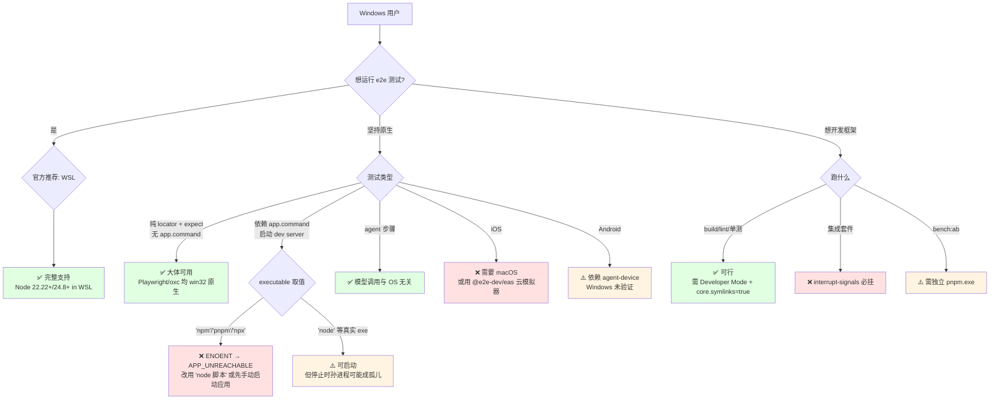

# e2e - Windows 兼容性分析

> 生成时间: 2026-10-11
> 分析基线: monorepo main @ 449fa936（e2e 0.19.0）
> 数据来源: windows-compat-checker 脚本扫描 + 全仓源码逐类核查（packages/、apps/、scripts/、examples/、docs/、.github/workflows）

## 总体评估

| 指标 | 结果 |
|------|------|
| 总体评级 | ⚠️ 部分兼容（分场景，见下表） |
| 高危问题（BLOCKER） | 2 |
| 中危问题（RISK） | 4 |
| 低危/信息项（INFO） | 10+ |
| 已正确适配项 | 14+（见 §7） |

### 分场景评级

| 场景 | 评级 | 说明 |
|------|------|------|
| **WSL 内运行测试（官方路径）** | ✅ 可用 | `docs/quickstart.mdx:35`："On Windows, run inside WSL." |
| 原生 Windows 运行 Web 测试 | ⚠️ 部分可用 | 常见路径有一个硬伤：`app.command` 无 shell spawn（§2.1）；应用已在跑或用 `node` 直接启动时基本可用 |
| 原生 Windows 运行移动测试 | ⚠️ 未验证 / 部分不可能 | iOS 天然需要 macOS（Xcode）；Android-on-Windows 依赖外部 agent-device 守护进程，未经项目验证；EAS 云模拟器客户端侧与 OS 无关 |
| 原生 Windows 开发框架本身 | ⚠️ 二等公民 | 构建/单测可跑；集成套件无法原生通过（§5.2）；零 Windows CI |

**结论先行**：代码层面明显认真考虑过 Windows（junction 符号链接、`USERPROFILE`/`APPDATA`/`SystemRoot`/`COMSPEC` 环境处理、`cmd /c start` 开浏览器、win32 专属 shell 分支），但**官方支持口径是 WSL**，且没有任何 Windows CI 兜底。在原生 Windows 上"能跑多少"取决于你是否踩到无 shell spawn 这颗雷。

## 1. 构建系统兼容性

### 1.1 package.json Scripts

| Script | 命令 | 问题 | 严重程度 |
|--------|------|------|----------|
| 根 `version-packages` | `changeset version && node scripts/restore-peer-ranges.ts && pnpm install --lockfile-only` | 仅 `&&` 链接 | ✅ 无问题（cmd/pnpm 均支持 `&&`） |
| 根 `canary:publish` | `changeset publish --tag canary --no-git-tag && node ...` | 仅 `&&` | ✅ 无问题 |
| 全部 8 包 + 3 app 的 scripts | `node`/`tsc`/`vitest`/`pnpm`/`oxlint`/`next`/`expo`/`eas`/`changeset`/`fallow` | 无管道、无 `$VAR`、无子 shell、无 `rm -rf`；dist 清理统一用 `node -e "require('node:fs').rmSync('dist',{recursive:true,force:true})"` | ✅ 无问题 |
| 根 `test:scripts` | `node --test "scripts/**/*.test.ts"` | glob 加引号由 Node 自身展开，不经 shell | ✅ 无问题 |

### 1.2 生命周期 Hooks

未发现（仓库用 `scripts/check-install-scripts.ts` 主动禁止包安装脚本；`pnpm-workspace.yaml` 的 `allowBuilds` 白名单只放行 esbuild，禁止 keytar/puppeteer/sharp 的构建脚本）。

### 1.3 构建工具链

| 工具 | Windows 支持 | 说明 |
|------|-------------|------|
| TypeScript 7 / tsc | ✅ | 纯 JS |
| oxc-parser / oxc-transform 0.152 | ✅ | 提供 win32 原生 binding（`packages/e2e/src/config/typescript.ts:41` 甚至按 `${process.platform}-${process.arch}` 报缺失 binding 的错误） |
| pnpm 12 | ✅ | 注意：npm 方式安装的 pnpm 在 Windows 是 `pnpm.cmd`（§2.1/§8 相关） |
| Vitest 5 / oxlint / changesets / fallow | ✅ | 纯 JS 工具链 |
| Playwright（经 playwright-core） | ✅ | 浏览器由 `node playwright-core/cli.js` 下载（`packages/web/src/install.ts:59,190`），`chrome-headless-shell.exe` 的 .exe 命名已处理（`install.ts:15`） |

## 2. 源代码兼容性

### 2.1 child_process 调用（核心问题所在）

| 文件:行 | 调用 | 评估 |
|---------|------|------|
| `packages/e2e/src/run/managed-process.ts:193` | `spawn(executable, args, …)` **无 `shell` 选项**（契约见 `docs/reference/config.mdx`："Resolved with PATH; never shell-interpreted"） | ❌ **BLOCKER（原生 Windows）**：文档与全部示例的 `executable` 取值是 `'npm' \| 'pnpm' \| 'npx'`（`docs/web.mdx`、`docs/reference/config.mdx`、`examples/with-next|with-vite|with-astro|with-expo/e2e.config.ts`、`apps/web-benchmark/e2e.config.ts`）。这些在 Windows 上是 `.cmd` 垫片，Node ≥18.20（CVE-2024-27980 修复后）无 shell 的 spawn 对其报 ENOENT → 干净的 `APP_UNREACHABLE`，但被管理的 dev server 起不来。`apps/testbed/*` 用 `executable: 'node'`，原生可跑 |
| `packages/e2e/src/run/managed-process.ts:47` | `process.kill(-pid, signal)`（进程组击杀）；win32 分支退化为 `child.kill(signal)` | ⚠️ **RISK**：Windows 无进程组，只终止直接子进程；`npm run dev` 之下的孙进程（实际 dev server）可能成为孤儿 → 后续运行 `APP_ALREADY_RUNNING`。无 `taskkill /T` 兜底 |
| `packages/e2e/src/run/managed-process.ts:196` | `detached: process.platform !== 'win32'` | ✅ 正确的平台化适配 |
| `packages/e2e/src/run/worker/handle.ts:61,105` | `fork()` + `SIGKILL`；入口经 `fileURLToPath` 解析 | ✅ |
| `packages/e2e/src/internal/git.ts:17-22` | `execFileAsync('git', …, { windowsHide: true })` | ✅（全仓唯一 `windowsHide` 使用者） |
| `packages/e2e/src/oauth/providers/github-copilot.ts:113` | `execFileAsync('gh', …)` | ✅（gh.exe 在 PATH 可解析） |
| `packages/e2e/src/oauth/cli.ts:256-262` | 打开浏览器：darwin `open` / **win32 `cmd /c start`（`&` 已转义）** / 其余 `xdg-open` | ✅ 完整三分支 |
| `packages/e2e/src/cli/init.ts:313` | `spawnSync(manager, ['install'], { shell: process.platform === 'win32' })` | ✅（显式为 win32 开 shell 以解析 npm/pnpm 的 .cmd 垫片——证明作者知道这个问题，只是 `managed-process` 采取了相反的严格策略） |
| `packages/eas/src/project.ts:57,84` | `execFileAsync(process.execPath, [expoCliJs, …])`（用 node 直接跑 CLI 的 JS 入口） | ✅ 刻意跨平台 |
| `packages/web/src/install.ts:59,190` | `spawn(process.execPath, playwrightCliArgs(…))` | ✅ |
| `packages/smol/src/machines.ts:60` + `provider.ts:181-218` | `machine.exec(['sh', '-c', script])`、`set -e`、`nohup setsid`、`/tmp/...` | ✅ 全部在 smol **Linux microVM 客体内**执行，与宿主 OS 无关 |
| `scripts/bench-ab.ts:93,108-123` | `execFileSync('git', …)` ✅；`execFileSync('pnpm', …)` 无 shell | ⚠️ **RISK**：`pnpm bench:ab` 在 Windows 需要独立 pnpm.exe |
| `scripts/install-smoke.ts:43-52` | `spawnSync(cmd, args, { shell: win32 })` 包裹 npx/pnpm | ✅（`:56` 的 `file:D:\…` 反斜杠 tarball 指定为低危问题，pnpm 通常容忍） |

### 2.2 平台守卫（证明 Windows 被认真考虑过的证据）

| 文件:行 | 守卫 | 评估 |
|---------|------|------|
| `packages/e2e/src/run/managed-process.ts:13` | 子进程环境显式继承 `PATH, HOME, TMPDIR, TMP, TEMP, SystemRoot, COMSPEC` | ✅ Windows 必需变量全覆盖 |
| `packages/e2e/src/cli/init.ts:281` | `symlinkSync(target, path, win32 ? 'junction' : 'dir')` | ✅ junction 无需符号链接特权；相对目标经 Node 规范化安全 |
| `packages/e2e/src/cli/init/engines.ts:21` | `ios = os.platform() === 'darwin'` → 向导在 Windows 上脚手架 Android | ℹ️ INFO |
| `packages/e2e/src/telemetry/store.ts:55-57` | win32 → `%APPDATA%\e2e`，否则 XDG | ✅ |
| `packages/e2e/src/telemetry/environment.ts:111-121` | `/.dockerenv`、`/proc/1/cgroup` 探测有守卫；`WSL_DISTRO_NAME` 检测 WSL | ✅（遥测分类专用） |
| `packages/eas/src/credentials.ts:47` | win32 → `USERPROFILE`，否则 `HOME` | ✅ |
| `packages/web/src/provider.ts:204`、`packages/e2e/src/internal/globs.ts:52` | 同时接受 `path.posix` 与 `path.win32` 的绝对路径 | ✅ |
| `packages/e2e/src/collect/collect.ts:225` | 测试注释显式用 `path.win32` 覆盖盘符/UNC 语义 | ✅ |
| `packages/e2e/src/cli/init.ts:347` | win32 用双引号、否则单引号的展示文案 | ℹ️ INFO |

**没有任何产品代码在 Windows 上显式报错或警告**——唯一的"不支持"声明是文档层面的（WSL 指引）。

### 2.3 Unix 专用 API

未发现宿主侧 Unix 专用 API。所有 `/tmp/...`、`set -e`、`setsid` 等 POSIX 用法都在远程/VM 客体侧（Kernel 云浏览器磁盘、smol microVM、telemetry 守卫探测），见 §2.1 与 §3.1 的逐条归属。**全仓零 `.sh` 文件**（已用 find 验证，排除 node_modules）。

## 3. 文件系统兼容性

### 3.1 路径处理

| 检查项 | 结果 |
|--------|------|
| `fileURLToPath`/`pathToFileURL` 使用 | ✅ 全仓一致（`config/esm-hooks.ts`、`config/specifiers.ts`、`run/worker/handle.ts`、`collect/registry.ts`、`cli/skill.ts` 等） |
| `path.join`/`path.resolve` | ✅ 普遍使用；正斜杠字符串只出现在展示文本与 junction 目标 |
| 硬编码 POSIX 绝对路径 | ✅ 全部位于远程/客体磁盘：`packages/kernel/src/provider.ts:51`（`/tmp/e2e-downloads`，Kernel 云浏览器自己的磁盘）、`packages/smol/src/provider.ts:21-195`（microVM 内）、telemetry 守卫探测 |
| 临时目录 | ✅ 统一 `mkdtempSync(path.join(tmpdir(), …))` |
| `~` 展开 | ✅ 无手写展开，一律 `os.homedir()`/`USERPROFILE` |
| EOL | ℹ️ 无 `.gitattributes`；CRLF 检出仅影响 `scripts/check-docs-package-managers.ts:35` 的 `split('\n')`（正则容忍 `\r`），属外观问题 |

### 3.2 符号链接

| 位置 | Windows 处理 | 说明 |
|------|-------------|------|
| `packages/e2e/src/cli/init.ts:281`（产品代码唯一写符号链接处） | ✅ junction 回退 | 有单测锁定（`tests/unit/cli-init.test.ts:321`："A junction works on Windows without the symlink privilege"） |
| 其余 symlink API（`internal/paths.ts:41-45`、`cli/init/mcp-config.ts:76-86`、`internal/globs.ts:221`） | ✅ 只读/检测，拒绝穿透链接写入；glob 不跟随符号链接 | |
| 仓库开发用 `.claude/skills` → `.dev/skills` 相对符号链接 | ⚠️ 需要 **Developer Mode + `git clone -c core.symlinks=true`**（`CONTRIBUTING.md:55-57`、`AGENTS.md:186-187` 已成文） | 仅影响在本机开发仓库本身 |

## 4. Shell 和脚本兼容性

### 4.1 Shell 脚本

| 检查 | 结果 |
|------|------|
| `.sh` 文件 | **0 个**（全仓验证） |
| `.ps1` / `.cmd` | 不需要（无对应 .sh） |
| 示例项目 Gradle wrapper | ✅ `gradlew` + `gradlew.bat` 齐全（with-compose、with-kotlin-multiplatform） |

### 4.2 环境变量

| 变量 | 处理 | 评估 |
|------|------|------|
| `PATH`/`SystemRoot`/`COMSPEC`/`TEMP`/`TMP` | 被 `managed-process.ts:13` 显式继承给子进程 | ✅ |
| `USERPROFILE`（eas 凭据）、`APPDATA`（遥测存储、`docs/reference/environment.mdx:76`） | 有 win32 分支 | ✅ |
| `WSL_DISTRO_NAME` | 遥测识别 WSL 环境 | ℹ️ INFO |
| shell 内 `$VAR` 引用 | 无 | ✅ |

## 5. 测试和 CI/CD 兼容性

### 5.1 CI 配置

| 工作流 | Runner | Windows 支持 |
|--------|--------|--------------|
| `spec.yml` / `benchmark.yml` / `docs.yml` / `review-label.yml` / `agent.yml` / `release.yml` | `blacksmith-4vcpu-ubuntu-2404`（release 用 `ubuntu-latest`） | ❌ 仅 Linux |
| `mobile.yml` | ubuntu-2404（Android KVM）+ `blacksmith-6vcpu-macos-26`（iOS） | ❌ Linux/macOS |

**没有任何 Windows CI job**——原生 Windows 回归无人兜底，这是"部分兼容"状态会持续的直接原因。

### 5.2 测试覆盖

| 测试类型 | Windows 是否覆盖 | 说明 |
|----------|------------------|------|
| 单元测试（各包 `tests/unit`） | ✅ 大体可跑 | 多处 win32 感知（`telemetry-store.test.ts:12` 处理 chmod 差异等） |
| 集成测试套件 | ❌ **必挂** | `packages/e2e/tests/integration/interrupt-signals.test.ts:230,256` 使用 POSIX 进程组击杀 `process.kill(-child.pid, signal)` 且**无 Windows skip** |
| 基准/移动套件 | ❌ | `mobile-benchmark` 用 `xcrun simctl`（macOS 专属）；web-benchmark 配置用 `executable: 'pnpm'`（踩 §2.1 的雷） |

## 6. 依赖兼容性

### 6.1 原生模块

| 依赖 | 是否原生 | Windows 支持 |
|------|----------|--------------|
| oxc-parser / oxc-transform / @oxc-project/runtime | 是（预编译 binding） | ✅ 有 win32-x64 binding |
| playwright-core | 否（下载浏览器二进制） | ✅ Chromium/Firefox/WebKit 均有 Windows 版 |
| agent-device 0.21.22（mobile 的设备层） | 外部守护进程 | ⚠️ **未验证**：守护进程对 Windows + Android SDK/adb 的支持取决于上游（callstack/agent-device），本仓库不控制 |
| zod / commander / @clack/prompts 等 | 否 | ✅ |

### 6.2 可疑依赖

无 `cross-spawn` 类依赖——这正是 `.cmd` 垫片 spawn 问题存在的原因（见 §8 建议 1）。

## 7. 已正确处理的适配

| 适配项 | 文件:行 | 处理方式 |
|--------|---------|----------|
| 符号链接 | `cli/init.ts:281` | win32 用 junction（无需特权），有单测 |
| 打开浏览器 | `oauth/cli.ts:256-260` | 三平台分支，`cmd /c start` 且转义 `&` |
| npm/pnpm install | `cli/init.ts:313`、`scripts/install-smoke.ts:43` | win32 显式 `shell: true` |
| 进程组 | `managed-process.ts:47,196` | win32 退化击杀 + 不脱离进程组（孙进程问题见 RISK） |
| 环境继承 | `managed-process.ts:13` | SystemRoot/COMSPEC 等 Windows 必需变量白名单 |
| 可执行文件命名 | `web/src/install.ts:15` | `chrome-headless-shell.exe` |
| 遥测存储 | `telemetry/store.ts:55-57` | `%APPDATA%\e2e` |
| 用户主目录 | `eas/src/credentials.ts:47` | `USERPROFILE` 回退 |
| 路径双兼容 | `web/src/provider.ts:204`、`internal/globs.ts:52` | posix/win32 绝对路径都接受 |
| CLI 直跑 | 各 app 测试脚本 | `node node_modules/e2e/dist/cli/bin.js`，不经 npx 垫片 |
| Expo CLI | `eas/src/project.ts:57,84` | `process.execPath` + JS 入口，绕开 .cmd |
| 终端输出 | `cli/wordmark.ts:15-260` | ANSI 同步输出有 TTY/NO_COLOR/`TERM!=dumb` 守卫，conhost 忽略无害 |
| Ctrl-C 阶梯 | `cli/signals.ts:43-44` | Node 在 Windows 控制台模拟 SIGINT，可用 |
| git 调用 | `internal/git.ts:17-22` | `windowsHide: true` |

## 8. 修复建议

### 8.1 必须修复（HIGH，若目标是原生 Windows 支持）

1. **`managed-process.ts:193` 的无 shell spawn**（BLOCKER）。三个方向任选：
   - 引入 `cross-spawn`（社区标准解法，自动解析 `.cmd`/`.bat`/`.ps1` 垫片）；
   - win32 下按 `init.ts:313` 的先例显式 `shell: true`（注意配 `windowsVerbatimArguments` 与参数转义）;
   - 保持现状但把文档与示例的 `executable` 全面改为 `node <脚本>` 形式，并在 `APP_UNREACHABLE` 错误信息中提示 Windows 用户改用 WSL 或真实可执行文件。
2. **Windows 进程树终止**（RISK）：`signalProcessGroup` 的 win32 分支增加 `taskkill /PID <pid> /T /F` 回退，避免 dev server 孤儿进程导致 `APP_ALREADY_RUNNING`。

### 8.2 建议修复（MEDIUM）

3. `interrupt-signals.test.ts:230,256` 为 win32 加 skip 或条件断言，让集成套件能在原生 Windows 上跑完（哪怕部分跳过）。
4. `scripts/bench-ab.ts:108-123` 的 `execFileSync('pnpm', …)` 加 win32 shell 或文档标注需独立 pnpm.exe。
5. 增加一个 Windows CI job（哪怕只跑 `pnpm --filter e2e run test:unit` + `pnpm check` 的子集），把"已考虑 Windows"从代码事实变成受测事实。
6. 验证并记录 agent-device 守护进程在 Windows + Android SDK 场景的支持状态（上游 callstack/agent-device 的问题，但值得在 mobile 文档中给 Windows 用户明确预期）。

### 8.3 可选改进（LOW）

7. `scripts/install-smoke.ts:56` 的 `file:D:\…` tarball 指定统一转成正斜杠。
8. 添加 `.gitattributes`（`* text=auto eol=lf`）消除 CRLF 检出的外观问题。
9. 在 `docs/quickstart.mdx` 之外，给 Windows 原生用户写一页"已知限制"（app.command、进程孤儿、移动端），把隐性行为显性化。

## 9. 兼容性决策流程图

## 10. 总结

e2e 对 Windows 的态度是"**代码尽力、文档指向 WSL、CI 不保证**"：

- **好消息**：全仓零 `.sh`、零 bash 语法脚本、零宿主侧 POSIX 硬编码路径；14+ 处显式 win32 适配（junction、`%APPDATA%`、`USERPROFILE`、`cmd start`、shell 分支）说明 Windows 在设计考虑之内；工具链（oxc、Playwright、pnpm、tsc）全部有原生 Windows 支持。
- **坏消息**：唯一的硬伤恰好卡在最常见的路径上——`app.command` 的无 shell spawn 与 npm/pnpm/npx 的 `.cmd` 垫片不兼容；其次是无进程树击杀、无 Windows CI、集成套件有 POSIX 假设。
- **对 Windows 用户的实际建议**：按官方口径用 **WSL**（一劳永逸）；必须原生时，让应用以 `node` 直启或复用已运行的应用（`reuseExisting`/直接给 `app.url`），避开 `app.command` 的垫片取值；iOS 测试走 `@e2e-dev/eas` 云模拟器。
