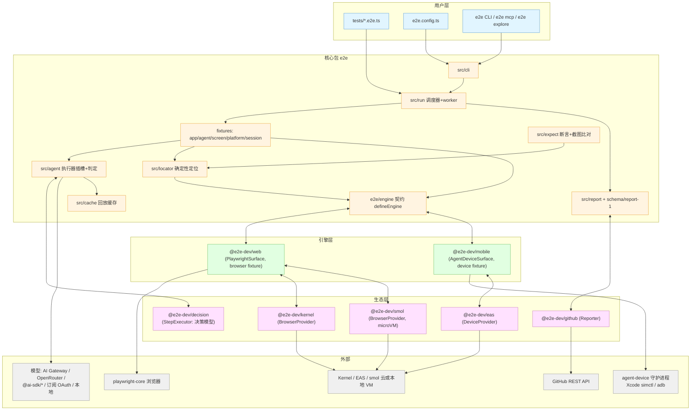

# e2e - 架构分析

> 生成时间: 2026-10-11
> 分析基线: monorepo main @ 449fa936（e2e 0.19.0）
> 数据来源: 分析脚本输出 + 源码探索（文件引用均相对 `packages/<pkg>`）

## 1. 项目概览

### 1.1 项目信息

| 项目 | 内容 |
|------|------|
| 名称 | e2e（仓库 `e2e-monorepo`，由 [TesterArmy](https://tester.army) 开发） |
| 语言 | TypeScript 7（928 个 .ts 文件），ESM only |
| 类型 | pnpm monorepo（npm 多包发布） |
| 描述 | An open framework for agentic end-to-end testing —— 自然语言驱动的 Web/移动端到端测试框架 |
| 许可证 | Apache-2.0 |
| Node 要求 | `^22.22.3 \|\| >=24.8.0` |
| 包管理 | pnpm 12.3.4（workspace: `packages/*`、`apps/*`、`docs`） |

### 1.2 目录结构

```
e2e/
├── packages/              # 发布到 npm 的包
│   ├── e2e/               # 核心：SDK + runner + CLI + engine 契约（0.19.0）
│   ├── web/               # @e2e-dev/web：Playwright Web 引擎（0.14.0）
│   ├── mobile/            # @e2e-dev/mobile：agent-device 移动引擎（0.11.0）
│   ├── decision/          # @e2e-dev/decision：决策模型执行器（0.2.0）
│   ├── kernel/            # @e2e-dev/kernel：Kernel 云托管浏览器（0.2.1）
│   ├── smol/              # @e2e-dev/smol：microVM 本地浏览器（0.1.0）
│   ├── eas/               # @e2e-dev/eas：EAS 云托管模拟器（0.3.1）
│   └── github/            # @e2e-dev/github：PR 评论 reporter（0.4.0）
├── apps/                  # 私有应用（按真实用户方式消费构建产物）
│   ├── testbed/           # dogfood：本地 playground + 全量 runner 特性确定性测试
│   ├── web-benchmark/     # Next.js 高难度 Web 场景基准（shadow DOM/canvas/iframe/预置 bug）
│   └── mobile-benchmark/  # Expo 高难度移动场景基准（无障碍树/系统弹窗/键盘遮挡/WebView）
├── examples/              # 8 个独立示例项目（Vite/Next/Astro/Expo/SwiftUI/Compose/KMP/Flutter）
├── docs/                  # Mintlify 文档站（构建时复制进 e2e 包随 npm 发布）
├── skills/                # 消费者可安装的 agent skill（npx skills add tester-army/e2e）
├── scripts/               # 仓库维护脚本（check-peer-ranges、bench-ab、canary 等）
└── .dev/skills/           # 仓库内部开发用 skill
```

## 2. 架构设计

### 2.1 架构模式

**契约驱动的插件化单体（monorepo + 单向 peer 依赖 + 按值注册）**。整体是三层：

1. **核心层（`e2e` 包）**：SDK 表面（`test`/`expect`/fixture）、自研 runner、CLI、以及平台中立的 `e2e/engine` 契约。核心**从不 import 任何引擎**——`src/` 中不允许出现 `Web`/`browser`/`page`/`playwright` 等名词（AGENTS.md 记载的 grep 零命中不变量，唯一例外是 `init` 脚手架写入用户配置的文本）。
2. **引擎层（`web`、`mobile`）**：各自用公开的 `defineEngine()` 组装引擎清单，依赖 `e2e`（peer，单向），在用户配置里以 `engine: web()` / `engine: mobile()` 的**值**注册。核心既无默认引擎，也无引擎注册表——引擎对象由用户配置代码构造并传入。
3. **生态层（`decision`、`kernel`、`smol`、`eas`、`github`）**：分别挂接核心/引擎暴露的四个接缝（见 2.4），全部是薄适配器，vendor SDK 一律 peer 或懒加载。

补充模式：

| 模式 | 体现 |
|------|------|
| 自研测试 runner | 不基于 Playwright Test/Vitest runner；`expect` 仅复用 `@vitest/expect` 断言库（`src/expect/index.ts`），API 风格借鉴 Playwright（role locator、`test.extend`、serial group、trace/video） |
| oxc 即时编译加载 | 测试文件与 `e2e.config.ts` 在 import 时由 `oxc-transform` 编译（`src/config/esm-hooks.ts`、`typescript.ts`），内联 sourcemap，尊重项目 tsconfig |
| 线格式即契约 | `packages/e2e/schema/*.schema.json`（report-1、session-1、agent-judgment-2）定义数据交换格式，各带正反 fixture 由集成测试校验 |
| 能力声明（capability） | `defineEngine` 在配置加载期大声校验引擎清单并计算能力集；残缺引擎直接失败运行而非静默降级（`src/engine/manifest.ts`） |
| 失败关闭（fail-closed）安全 | 秘密不进模型输入、工具调用先解析进封闭 schema 并即时授权、导航走统一 URL 规则（详见运行机制分析 §2.7） |

### 2.2 核心模块（packages/e2e/src）

| 模块 | 职责 | 关键文件 |
|------|------|----------|
| `src/run/` | runner 核心：编排、调度、worker、重试、会话 | `runner.ts`、`scheduler.ts`、`units.ts`、`execute.ts`、`worker/`、`fixtures.ts`、`serial.ts`、`retry.ts` |
| `src/collect/` | 测试发现、注册、选择 | `collect.ts`、`registry.ts`、`select.ts` |
| `src/config/` | 配置发现/加载/解析（含 TS/ESM 加载器） | `load.ts`、`esm-hooks.ts`、`resolve.ts`（1078 行）、`targets.ts` |
| `src/engine/` | 引擎 SPI：中立词汇表、Engine 接口、defineEngine、会话适配 | `contract.ts`、`index.ts`（839 行）、`manifest.ts`、`session.ts` |
| `src/agent/` | agent fixture 与 act/assert 执行、工具循环、观察流 | `act.ts`、`default-agent.ts`、`tool-loop.ts`、`executor.ts`、`action-dispatcher.ts`、`observation-feed.ts`、`model/` |
| `src/cache/` | 回放缓存：身份键、文件存储、录制、保守重定位、锚点 | `identity.ts`、`store.ts`、`recorder.ts`、`relocate.ts`、`anchors.ts`、`trace.ts`（975 行） |
| `src/locator/` | 确定性 `screen`/Locator（无模型） | `screen.ts`、`expression.ts`、`engine.ts` |
| `src/expect/` | expect 实现：值匹配、`expect.poll`/`soft`、locator 断言、截图比对 | `index.ts`（pixelmatch/fast-png） |
| `src/report/` | 报告生成：report.json、终端 list、junit、markdown、trace 页 | `build.ts`、`list.ts`、`markdown.ts`、`traces.ts` |
| `src/cli/` | Commander CLI：init/login/run/explore/cache/guide/mcp 等 | `bin.ts`、`index.ts`、`init/` |
| `src/mcp/` | `e2e mcp` 服务器：把活会话暴露给编码代理 | `server.ts`、`tools.ts` |
| `src/oauth/` | 订阅登录与 `e2e/oauth/*` 模型构造器 | `chatgpt.ts`、`copilot.ts`、`grok.ts`、`opencode-console.ts`、`providers/` |
| `src/explore/` | `e2e explore` 目标驱动探索 | `explore/` |
| `src/telemetry/` | 匿名 PostHog 遥测 | `telemetry.ts` |
| 根 | 公共 API（`index.ts`）、全部公共类型（`types.ts`，1534 行）、`unique()`、credentials/secrets | |

### 2.3 包职责矩阵

| 包 | 角色 | 依赖方向 | 运行时重依赖 |
|----|------|----------|--------------|
| `e2e` 0.19.0 | SDK + runner + CLI + engine 契约 | 被 engine 依赖（peer） | 无浏览器/测试框架依赖；oxc、commander、zod 等 14 个精确锁定依赖 |
| `@e2e-dev/web` 0.14.0 | Web 引擎（Chromium/Firefox/WebKit） | peer `e2e >=0.18.0 <1` | 仅 `playwright-core` 1.63.0（精确锁定） |
| `@e2e-dev/mobile` 0.11.0 | iOS/Android 引擎 | peer `e2e >=0.15.0 <1`（+ 可选 `ai`） | `agent-device` 0.21.22、pngjs、zod |
| `@e2e-dev/decision` 0.2.0 | 决策模型执行器（替换 agent "大脑"） | peer `ai ^7.0.134`、`e2e >=0.19.0` | pngjs、zod |
| `@e2e-dev/kernel` 0.2.1 | Kernel 云托管 Chromium | peer `@e2e-dev/web`、`@onkernel/sdk`、`e2e` | 无（SDK 懒加载） |
| `@e2e-dev/smol` 0.1.0 | 本地 microVM Chromium（copy-on-write 分支） | peer `@e2e-dev/web`、`smolmachines >=1.25.1`、`e2e` | 无（SDK 局部切片） |
| `@e2e-dev/eas` 0.3.1 | EAS 云托管 iOS/Android 模拟器 | peer `@e2e-dev/mobile`、`e2e` | 无（原生 fetch 调 Expo GraphQL） |
| `@e2e-dev/github` 0.4.0 | GitHub Actions PR 评论 reporter | peer `e2e >=0.15.0` | 无（fetch 调 REST） |

### 2.4 四个扩展接缝

所有生态包都通过公开接缝挂接，核心对它们零感知：

| 接缝 | 契约位置 | 谁实现 | 注册方式 |
|------|----------|--------|----------|
| **Engine SPI** | `e2e/engine`（`src/engine/contract.ts` 词汇表：`SemanticNode`、`LocatorExpression`、`NodeRef`、动作语法、`EngineError` 封闭错误码集；`src/engine/index.ts` `Engine` 接口 + `defineEngine`） | web、mobile（及用户自定义引擎） | 用户配置 `targets: [{ engine: web() }]`，`EngineHandle` 按值传入 |
| **BrowserProvider / DeviceProvider** | 引擎级接缝（`packages/web/src/provider.ts` `acquire/release/record/sweep` → CDP 端点；`packages/mobile/src/provider.ts` → agent-device 守护进程地址） | kernel、smol（web）；eas（mobile） | `web({ browser: kernel() })` / `mobile({ device: easSimulators() })` |
| **StepExecutor** | `src/agent/executor.ts`（`runStep(context)` + 强制预算/录制/判定语法；该模块刻意不 import AI SDK） | decision 包、用户自定义（可完全无模型） | `agents.default.executor = decisionExecutor({ model })` |
| **Reporter** | `src/types.ts`（`onRunFinished`，report.json 写完后一次性调用，不能改退出码） | github 包、用户自定义 | `reporters: ['list', github()]` |

另有项目级工具接缝 `defineTool`（`e2e/agent`，如 `@e2e-dev/mobile/tools` 的 `open_app`/`swipe`/`alert`）。

### 2.5 架构图



要点：`e2e`（核心）与引擎/生态包之间只有一条依赖边——**引擎和生态包单向 peer 依赖核心**，核心对它们零 import；模型、引擎、执行器、reporter 全部在用户配置里按值注入。

## 3. 依赖关系分析

### 3.1 核心包外部依赖（全部精确锁定版本）

| 依赖 | 版本 | 用途 |
|------|------|------|
| `@oxc-project/runtime` / `oxc-parser` / `oxc-transform` | 0.152.0 | 测试文件与配置的 TS 即时编译、AST 解析 |
| `commander` | 15.0.0 | CLI 框架 |
| `zod` | 4.6.1 | 模式校验（判定输出、决策问题等） |
| `@ai-sdk/provider` | 4.0.21 | AI SDK provider 类型（核心不含任何具体厂商 SDK） |
| `@vitest/expect` | 5.0.3 | expect 断言库（非测试 runner） |
| `@modelcontextprotocol/server` | 2.3.0 | `e2e mcp` 服务器 |
| `pixelmatch` / `fast-png` | 8.0.0 | 截图视觉比对 |
| `@clack/prompts` | 1.8.1 | init/login 交互向导 |
| `@jridgewell/remapping` / `get-tsconfig` / `picocolors` | — | sourcemap 组合 / tsconfig 读取 / 终端着色 |

可选 peer（`peerDependenciesMeta` 全 optional）：`ai ^7.0.0`、`@ai-sdk/anthropic ^4`、`@ai-sdk/google ^4`、`@ai-sdk/openai ^4`、`@ai-sdk/openai-compatible ^3`、`@ai-sdk/xai ^5` —— **AI SDK 懒加载**（`src/agent/ai-sdk.ts`，缓存在 `globalThis` 槽），确定性套件与无模型 executor 永不加载它。

### 3.2 依赖健康度

- **核心包零重型依赖**：无浏览器、无测试框架 runner，发布体积与供应链面最小化；`scripts/check-install-scripts.ts`、`pnpm-workspace.yaml` 的 `allowBuilds` 白名单限制原生构建脚本（esbuild 允许，keytar/puppeteer/sharp 禁止）。
- **安全覆盖**：workspace `overrides` 强制升级 js-yaml/nanoid/undici/fast-uri 已知漏洞版本。
- **peer 范围单向**：engine→`e2e`、integration→engine，格式固定 `>=x.y.z <major+1>`，由 `scripts/check-peer-ranges.ts` 在 CI 强制；避免 changesets 级联补丁重发全部引擎。
- **依赖循环**：`e2e` devDepends `@e2e-dev/web`（集成测试用浏览器）而 web peer-depends `e2e`，workspace 显式 `ignoreWorkspaceCycles: true`，构建顺序在根脚本里手工排列。
- 仓库工具链：oxlint（lint）、fallow（死代码检查）、changesets（发布）、Vitest 5（包内单测/集成）、TypeScript 7。

## 4. 设计亮点与评价

1. **契约先行**：`dist/*.d.ts` 即公共 API；wire 格式有 JSON Schema + fixture；错误码由 `scripts/check-error-codes.ts` 校验"源码与文档一一对应"。
2. **可替换的大脑**：agent 的"思考层"被抽象成 `StepExecutor` 插座，默认实现是 AI SDK Tool Loop，可换成 `@e2e-dev/decision` 的概率分布决策模型，也可换成用户手写的无模型执行器——harness 始终强制预算、录制、判定语法。
3. **观测语义树而非 DOM**：引擎产出平台中立的 `SemanticNode` 树（role/name/text/states/rect），Web 引擎自研 in-page 读取器（非 Playwright ariaSnapshot），并有 axe-core 一致性 + Chrome CDP 无障碍树双重 oracle 交叉验证（`packages/web/tests/crosscheck/`）；移动端有金样本设备树快照测试。
4. **回放缓存作为一等公民**：录制必须在后续验证步骤通过后才落盘；回放时保守重定位目标节点（唯一匹配或放弃），端点锚点校验终态——"确定性回放 + 优雅降级到模型"贯穿全局（详见运行机制分析）。
5. **安全不变量成文且被测试锁定**（`tests/integration/agent-policy.test.ts`）：秘密永不进模型输入、工具调用封闭 schema 授权、导航统一 URL 规则、会话 AES-256-GCM 加密即删。
