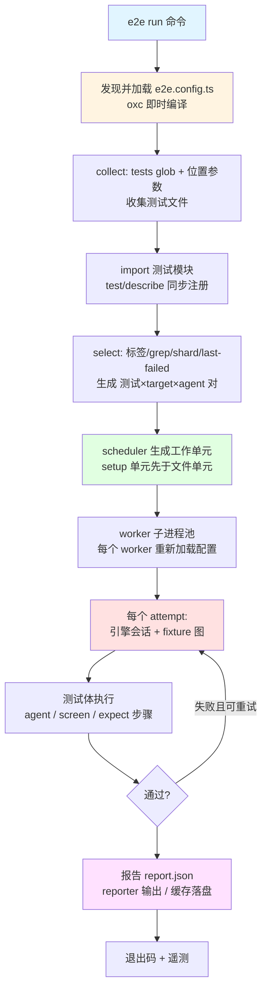
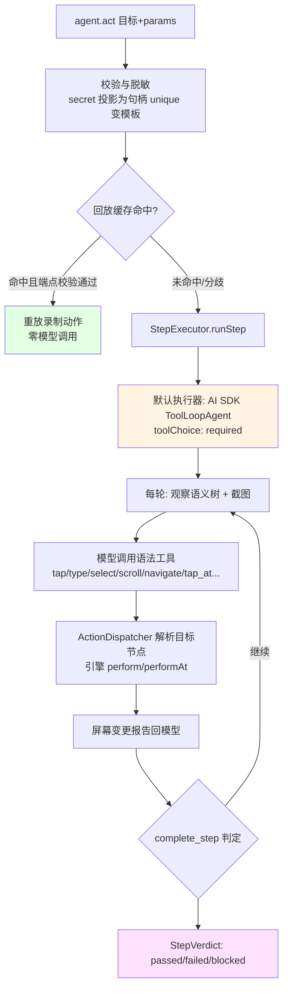
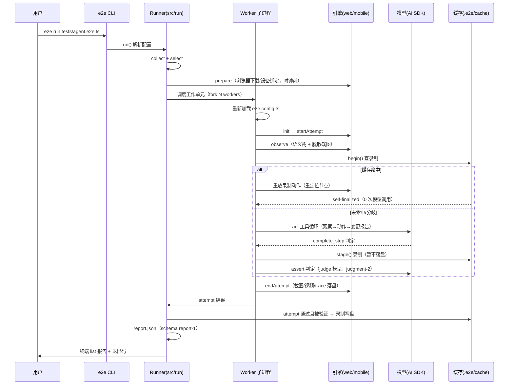

# e2e - 运行机制详解

> 生成时间: 2026-10-11
> 分析基线: monorepo main @ 449fa936（e2e 0.19.0）
> 文件引用均相对 `packages/e2e`（除注明包名外）

## 一、项目运行方式

`e2e` 是一个**自研 runner**（不基于 Playwright Test 或 Vitest runner），以 CLI 为主入口。`bin` 指向 `dist/cli/bin.js`（源码 `src/cli/bin.ts`）：先校验 Node 版本，再加载 `src/cli/index.ts` 的 `main()`，由 Commander 组装全部子命令。

**子命令**（定义于 `src/cli/index.ts`）：

| 命令 | 行号 | 作用 |
|------|------|------|
| `init` | 418 | 脚手架（引擎/模型向导），实现于 `src/cli/init/`（engines.ts 预设、scaffold.ts、mcp-config.ts、agent-skill.ts） |
| `login` / `logout` / `models` | 441/460/470 | 订阅 OAuth（ChatGPT、Copilot、OpenCode Console、SuperGrok），实现于 `src/oauth/cli.ts` |
| `guide` | 483 | 打印给编码代理的 skill 文档 |
| `mcp` | 494 | stdio MCP 服务器（`open_session`/`call`/`tools`/`close_session` 四个工具） |
| `run` | 523 | 主命令：选择、执行、报告 |
| `explore` | 645 | 目标驱动探索（`--max-steps`/`--timeout` 预算） |
| `list` | 739 | 只做收集+选择，打印 测试×target×agent 三元组 |
| `cache ls/stats/clear` | 806 | 检查/清空回放缓存 |
| `feedback` / `telemetry` | 836/871 | 反馈与遥测开关 |

退出码表（`src/cli/index.ts:262-269`）：0 通过，1 测试失败，2 CLI/配置错误，3 引擎/模型/产物错误，4 内部错误，130 中断。

### 执行流程

## 二、核心运行机制

### 2.1 测试发现与即时编译加载

**位置**: `src/collect/collect.ts`、`src/config/load.ts`、`src/config/esm-hooks.ts`、`src/config/typescript.ts`

**说明**: 测试文件没有预编译步骤——**import 时由 oxc 编译**。`compileTimeScript`（`typescript.ts:244`）用 `oxc-transform` 按当前 Node 版本为目标转译 TS，内联 sourcemap（`@jridgewell/remapping` 组合），尊重项目 tsconfig 的 JSX/装饰器/class-field/paths 别名，并按 TS 规则把 `./x.js` 解析回 `x.ts`。`importModule`（`load.ts:104`）用带缓存击穿查询参数的 URL 动态 import。

模块求值期间，从 `e2e` 导入的 `test()`/`describe()` **同步注册**。关键机制：当前 `Collector` 实例通过 `globalThis` 上的 `Symbol.for('e2e.activeCollector.v1')` 槽传递（`src/collect/registry.ts:442`）——即使测试项目里装了另一份 e2e 副本，注册也能到达 runner 的收集器。文件收集支持 `file:line` 定位、路径尾段/基名匹配，glob 未命中时给出近名建议（`*.test.ts` 之类，`collect.ts:128-166`）。

**机制作用**:
- 零构建步骤：用户写 TS 测试直接跑，sourcemap 保留原始行号。
- 单一事实源：配置、测试、引擎工厂在同一进程模型里以值传递。
- 副本隔离：Symbol.for 全局槽让"两份 e2e"共享一个收集器，规避 npm 幽灵依赖问题。

### 2.2 调度与 worker 模型

**位置**: `src/run/runner.ts`（`run()` 于 347 行）、`src/run/scheduler.ts`、`src/run/units.ts`、`src/run/worker/`（`entry.ts`/`handle.ts`）、`src/run/in-process.ts`

**说明**: `select()` 产出 测试×target×agent 对（`src/collect/select.ts`），调度器按依赖组织**工作单元**：setup 单元（`test.setup` 会话）先于文件单元门控。worker 有两种形态：

- **子进程 worker**（`childProcessSpawner`，fork `worker/entry.ts`）：因为活的引擎句柄和模型实例无法跨 IPC 序列化，**每个 worker 重新加载配置模块**自行构造引擎/模型。
- **进程内 worker**（`in-process.ts`，单 worker）：服务 `e2e explore` 这类内存态运行。

attempt 生命周期在 `TargetExecutor.executeAttempt`（`src/run/execute.ts:801`）：启动引擎会话 → 构建 fixture → 测试体与截止时间/中断信号赛跑（`execute.ts:1118-1157`）→ `StepRecorder` 记录步骤时间线（`src/run/steps.ts`）。重试由 `runWithRetries` 驱动；`describe.serial` 组共享一个会话顺序执行（`serial.ts`）。引擎生命周期钩子按层触发：`prepare`（run/target 级，时钟启动前——浏览器下载在这里）→ `init`（worker 级）→ `startAttempt`/`settleAttempt`/`endAttempt`（attempt 级）→ `dispose`/`finish`。

### 2.3 引擎会话与 fixture 系统

**位置**: `src/run/fixtures.ts`、`src/engine/session.ts`、`src/engine/surface.ts`、`src/engine/manifest.ts`

**说明**: 引擎经 `createEngineSession`（`session.ts`）适配为 `TargetSession`：外语异常统一归一化为 `ENGINE_FAILURE`，能力门控（引擎未声明 `observe` 就调 observe 直接拒绝），可重试错误仅 `NODE_STALE`/`FRAME_NOT_FOUND`，`ACTION_MAY_HAVE_COMMITTED` 保证 harness 绝不盲目重放不确定的变更动作。

fixture 按尝试惰性构建（`fixtures.ts:94`）：五个保留核心 fixture —— **`agent`**（`fixtures.ts:210`）、**`app`**（open/restart/clearState/back/screenshot，映射引擎 `session.open/restart/reset`）、**`screen`**（确定性定位器）、`platform`、`session`（setup 专用保存）。引擎贡献的 fixture（web 的 `browser`、mobile 的 `device`）按引擎 `fixtures` 声明合并为惰性访问器（`fixtures.ts:285`），且不得遮蔽保留名（`manifest.ts:79`）。访问不存在的 fixture 走 Proxy 报定向错误，并给出 Playwright/WebDriver 习惯提示（`page`/`context`/`driver`）。`test.extend()` 的 fixture 链在注册期记录、运行期回放为定义（`extended-fixtures.ts`）。

### 2.4 agent.act：目标执行循环

**位置**: `src/agent/act.ts`（`runActStep` 73 行、`dispatchStep` 482 行）、`src/agent/default-agent.ts`、`src/agent/tool-loop.ts`、`src/agent/primitives.ts`、`src/agent/action-dispatcher.ts`、`src/agent/observation-feed.ts`

**说明**: 一次 `act` 的完整流程：

要点：

- **`ActDispatch` 四协作器**（`act.ts:194`）：`StepAccounting`（时钟、`maxSteps`/`maxModelCalls` 预算、硬停）、`ObservationFeed`（捕获、settle 策略、最近 8 次观察的节点 id 环、像素决策）、`ActionDispatcher`（动作语法 + 目标对最新观察解析）、`StepTraceSession`（录制/回放）。
- **工具即语法**：`createGrammarTools`（`primitives.ts:316`）按引擎声明的动词生成 `tap/type/press/select/scroll_to/navigate/observe/screenshot/tap_at` 等工具 + `complete_step` 判定工具；项目 `defineTool` 工具在同一预算下运行。
- **结论强制**：剩 ≤2 轮或时间低于 `min(60s, 预算/4)` 时只提供结论工具（`tool-loop.ts:636-666`）；`prepareTurn` 每轮应用消息压缩与循环守卫。
- **失败关闭结算**（`act.ts:404` `settle`）：硬停（预算/超时/取消）把 passed 改写为 blocked；模型报告的运行时错误码若 harness 无法佐证则判 `MODEL_OUTPUT_INVALID`。
- **卡顿守卫**：① 每请求 120s 停滞计时器（`model/stall.ts`），停滞响应中止并交传输层重试（共 5 次，`model/sdk.ts:42`）；② 纯函数循环检测器（`loop-guards.ts`）扫描工具调用转录——相同调用重复（3 警告/5 停止）、周期 2-4 的短循环（2/3）、变输入失败连击（3/5）；③ `ObservationFeed` 在状态变更动作后等屏幕 settle 再观察，避免模型"修复"已经成功的转场。

### 2.5 判定层：assert / waitFor / extract

**位置**: `src/agent/index.ts:239`、`src/agent/model/sdk.ts`、`schema/agent-judgment-2.schema.json`

**说明**: 默认路径下判定与 act 分离：**一次新观察 + 一次模型调用**（对 `agent-judgment-2` 线格式做结构化输出，加一轮修复机会，共 `ASSERT_MODEL_CALLS = 2`），使用 `agents.<name>.judge` 配置的判定模型（缺省回落到 `model`）。判定输出三值：`holds`（通过）/ `fails`（`ASSERTION_FAILED`）/ `inconclusive`（`ASSERTION_INCONCLUSIVE`）。

判定模型**永远看不到**前序步骤和 act 的摘要——只有陈述、脱敏的当前屏幕快照和 agent 的 `context`。这是刻意设计：判定只依赖证据，不受执行历史的"叙事污染"。自定义 executor 接管时，`assert` 走 executor 插座，`waitFor`/`extract` 的判定仍用内置判定层。

### 2.6 回放缓存（replay cache）

**位置**: `src/cache/`（`identity.ts`、`store.ts`、`recorder.ts`、`relocate.ts`、`anchors.ts`、`template.ts`、`context.ts`）、`src/agent/step-cache.ts`、`src/agent/replay.ts`

**说明**: 这是"第二次运行不花钱"的核心机制。

- **存储**: `.e2e/cache/` 下每键一个 JSON 文件（`trace-1` 格式，`trace.ts` 975 行定义）；`FileCacheStore`（`store.ts:55`）单条目 1 MiB 上限、临时文件+rename 原子写、读失败即关闭。可用自定义 `CacheStore`（Redis 等）整体替换。
- **键**（`identity.ts:39-60`）: 项目摘要、testId、targetId、平台、**引擎名 + SPI 版本**（刻意不含引擎包版本——重定位会重新校验节点）、步骤种类（只有 `act` 会缓存，判定永不缓存）、同签名调用序号、规范化指令摘要、**模板化参数**摘要（`unique()` 值变成槽位）、app identity、agent 名、脱敏 context 摘要、`REPLAY_POLICY_VERSION`。
- **录制推迟落盘**: 步骤结束时只 `stage()`（起始路由、结束路由、端点锚点=基线与通过屏幕之间的节点出现/消失差集、`endWaitMs`）；**只有 attempt 通过且后续验证步骤（assert/waitFor）确认后**才在 attempt 结束写盘（`settleStagedTraces`，`context.ts`；由 `execute.ts:1261` 调用）。失败或"被牵连未确认"的录制直接驱逐。
- **回放**: `StepTraceSession.begin()`（`step-cache.ts:242`）校验起始路由 → `replayTrace` 在**新观察中重定位**每个录制动作的目标描述（`relocate.ts`，保守策略：恰好一个匹配否则放弃，绝无模糊匹配）→ 全部重放后校验结束路由 + 锚点差集且回放确实呈现了它 → 完全成功则步骤**自完结（self-finalized），零模型调用**。
- **分歧降级**: 重放中途失败时 executor 收到 `ReplayedPrefix`（停止原因：`gap`/`target-not-found`/`target-ambiguous`/`viewport-changed`/`action-failed`/`action-uncertain`/`end-mismatch`），并带明确警告不得重做已重放的变更动作；模型从断点继续。
- **策略**: 默认 `read-write`；CI 未配置则降级 `read-only`；重试永不回放（只第一次 attempt）；`--strict-cache` 让过期录制报 `REPLAY_STALE` 而非回退模型（并用 `rekeyed.ts` 检测换键录制），且永不写缓存。

### 2.7 安全机制（fail-closed）

**位置**: `src/run/secrecy.ts`、`src/agent/executor.ts`、`src/agent/action-dispatcher.ts`、`src/agent/observation-feed.ts`、`src/run/sessions.ts`；测试锁定于 `tests/integration/agent-policy.test.ts`

**说明**（AGENTS.md "Security invariants" 的代码对应）：

- **秘密隔离**: 模型输入是脱敏语义树（文本或节点树）；`typeSecret` 只接受步骤 params 声明的句柄（`executor.ts:175-183`），值由 runner 授权填充（`secrets.ts` 的 `authorizeSecretFill` 要求：run 配置了该 secret + 节点可编辑 + 密码框才允许密码），目标在对最新观察解析后校验（`observation-feed.ts` 的 `feed.resolve`/`requireLatest`）。**模型永远看不到也不选择值**。填过 secret 后视口对本次 attempt 保持"像素污染"，不再发送截图。
- **工具调用授权**: 每次模型工具调用先解析进封闭 schema 并在分发前授权；未知工具/未声明字段作为该调用的错误结果回给模型（下一轮即修复轮），拒绝计数进失败连击守卫。模型文本永不被当作代码/选择器/shell 求值。
- **导航白名单**: 一切导航（`app.open`、`browser.goto`、`navigate` 动词）走 `resolveNavigationUrl` 单一规则——只放行 `http:`/`https:`/精确的 `about:blank`，其余 scheme 一律 `POLICY_DENIED`；移动端 `device.openLink` 反向拒绝 `file:`/`data:`/`javascript:` 等（`packages/mobile/src/links.ts`）。
- **会话加密**: per-run、绑定 target、AES-256-GCM、密钥仅存内存、清理时删除；payload 永不进诊断。

## 三、完整工作流程（典型 run 的时序）

## 四、数据流与状态管理

### 4.1 输出目录（默认 `.e2e/`）

| 路径 | 内容 |
|------|------|
| `report.json` | 规范报告（`report-1` schema），`--last-failed` 由此读取 |
| `results/<test>/` | 每测试一目录：trace 页 `trace.md`、截图/视频/下载/日志，每 attempt 一个 `attempt-<n>/` |
| `cache/` | 回放缓存 `trace-1` 条目（每键一 JSON） |
| `sessions/` | run 的加密 `test.setup` 会话，结束即删 |
| `junit.xml` / `summary.md` | junit / markdown reporter 产物 |
| `ai-trace.json` | `--ai-trace` 的模型调用记录（AI SDK devtools 库格式） |
| `videos/<session>/` | `e2e mcp` 会话录像 |

### 4.2 关键数据结构

| 结构 | 用途 | 定义位置 |
|------|------|----------|
| `SemanticNode` | 平台中立语义树节点（role/name/text/value/testId/states/rect/children） | `src/engine/contract.ts:130` |
| `NodeRef {id, revision}` | 跨观察稳定的节点 id（同一元素同 id，模型看到的是差分） | `src/engine/contract.ts` |
| `LocatorExpression` | 确定性查询（query/filter/index/selector/frame） | `src/engine/contract.ts:84` |
| `StepVerdict` | 步骤结论（passed/failed/blocked + errorCode） | `src/agent/executor.ts` |
| `ExecutorStep` / `StepExecutorContext` | 执行器插座的输入（含强制预算、动作语法、观察、账本） | `src/agent/executor.ts:381-464` |
| `E2EConfig` | 全部公共配置类型 | `src/types.ts:1447-1534` |
| wire schemas | report-1 / session-1 / agent-judgment-2 | `packages/e2e/schema/*.json` |

### 4.3 状态归属

- **per-attempt**: 引擎会话、fixture、观察环、像素污染状态、暂存录制。
- **per-run**: 调度状态、加密会话存储、报告、遥测。
- **跨 run 持久**: `.e2e/cache/` 回放缓存（可提交进 git）、OAuth 令牌存储、报告（供 `--last-failed`）。
- **跨副本共享**: `globalThis` 槽（收集器 `Symbol.for('e2e.activeCollector.v1')`、AI SDK 实例 `e2e.ai-sdk.v1`）。

## 五、扩展机制

| 扩展点 | 契约 | 典型实现 |
|--------|------|----------|
| 引擎 | `defineEngine`（能力声明 + 生命周期钩子 + fixture 贡献） | `@e2e-dev/web`、`@e2e-dev/mobile`、用户自定义 |
| 托管资源 | `BrowserProvider`（CDP 端点）/ `DeviceProvider`（agent-device 守护进程） | kernel、smol / eas |
| 步骤执行器 | `StepExecutor.runStep`（harness 强制预算/录制/判定语法，模块不 import AI SDK） | `@e2e-dev/decision`、无模型手写执行器 |
| 报告器 | `Reporter.onRunFinished`（report.json 之后，不改退出码） | `@e2e-dev/github` |
| 项目工具 | `defineTool`（`e2e/agent`，与语法工具同预算） | `@e2e-dev/mobile/tools` 的 `open_app`/`swipe`/`alert` |
| 模型 | 任何 AI SDK `LanguageModelV2+` 实例（结构检测） | gateway/openrouter/@ai-sdk/* / `e2e/oauth/*` |
| MCP | `e2e mcp` 把活会话暴露为工具（每次 MCP 调用都是 harness 动作） | Claude Code / Cursor 集成 |

## 六、配置管理

配置文件 `e2e.config.ts` 从 cwd 向上发现直到仓库根（`src/config/load.ts:36-63`），其目录即项目根；`--config` 可显式覆盖；近似命名（`e2e.config.js`、`e2e-config.ts`）会在错误中点名。配置模块同样经 oxc 加载。

解析管线：`E2EConfig`（用户） + CLI 覆盖 → `ResolvedConfig`（`src/config/resolve.ts:54`，1078 行）→ `ResolvedTarget`（`config/targets.ts:15`）。配置里**没有** "engine"/"provider" 字符串选项——引擎由 import 的引擎包构造、模型由 import 的 provider 包构造，runner 两者都不构造。CI 检测（`CI=1`）改变默认值：`workers→1`、`retries→1`、未配置的缓存降为只读、`test.only` 报 `ONLY_IN_CI`（退出码 2）、`command.reuseExisting` 被忽略。

## 七、总结

e2e 的运行时围绕六个核心概念：

1. **即时编译的自研 runner**：oxc 在 import 期编译 TS 测试与配置，Symbol.for 槽统一跨副本注册；子进程 worker 各自重载配置，活的引擎/模型实例永不跨 IPC。
2. **契约驱动的引擎会话**：`defineEngine` 能力声明 + 生命周期分层（prepare→init→startAttempt→…→finish），异常与错误码全量归一化。
3. **可替换的 agent 大脑**：默认 AI SDK Tool Loop（语法工具 + 结论强制 + 三重卡顿守卫），`StepExecutor` 插座允许决策模型或无模型执行器替换。
4. **证据独立的判定层**：assert/waitFor/extract 走 judge 模型 + `agent-judgment-2` 线格式，判定只看当前屏幕。
5. **验证后落盘的回放缓存**：录制在 attempt 通过且被后续断言确认后写盘；回放保守重定位 + 锚点校验，分歧优雅降级到模型。
6. **失败关闭的安全不变量**：秘密句柄化、工具调用封闭 schema 授权、导航单规则、会话内存密钥加密。

这套设计让同一套测试在"第一次跑（模型驱动、录制）"和"之后每次跑（确定性回放、零成本）"之间平滑切换，同时保持核心对引擎、模型、执行器的完全解耦。
